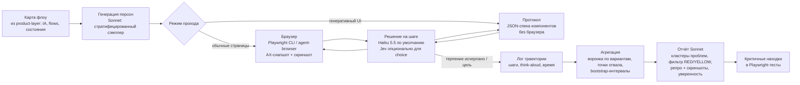

Дата: 2026-10-31. Это сводка. Подробные карточки, расчёты и все ссылки лежат в четырёх файлах рядом, в папке `2026-10-qa-user-simulation/`:
- `block1.md` — QA-скиллы для Claude (16 решений; SKILL.md и references прочитаны целиком, 17 репозиториев клонировано);
- `block2.md` — open-source симуляция пользователей (13 инструментов) и исследования о реализме;
- `block3.md` — Jev, Jevtown, decision-модели и две статьи arXiv 2610.*;
- `block4.md` — 13 коммерческих сервисов.

Цены моделей сверены с официальными прайсами 2026-10-31: Sonnet 5.5 — $2 / $10 за MTok, Haiku 5.5 — $0.10 / $0.50, Jev — $0.042 за MTok входа, выход бесплатный. Цена Jev подтверждена только вторичными источниками и статьёй. Все стоимости прогонов — оценки по допущениям, реальных прогонов не было.

## Главное

1. **Готового решения для генеративного UI в чате нет** ни среди скиллов, ни среди OSS, ни среди SaaS. Никто не ждёт конца стрима, не проверяет карточки, кнопки и слайдеры внутри сообщений, не проверяет stop/regenerate. Это придётся писать самим. Для product-layer это открытая ниша.
2. **Почти все dogfood-скиллы — потомки vercel-labs/agent-browser `dogfood`** (Apache-2.0). Hermes, pm-pilot и AojdevStudio — его форки или пересказы. У AojdevStudio шаблон совпадает с оригиналом байт в байт, атрибуции нет.
3. **Симуляция угадывает направление A/B-эффекта в 67–80% случаев** (SimAB; arXiv 2609.01038). Величину эффекта она не даёт. Следующее действие конкретного человека угадывается в ~12% случаев. Агенты гиперрациональны: 6 действий за сессию против 16 у людей (AgentA/B).
4. **Деньги — не узкое место.** 1000 персон в реальном браузере на Haiku 5.5 стоят $20–60. Узкие места — реализм и разнообразие поведения. Персона в промпте почти не меняет путь агента (vizron), а персоны из одной демографии заметно слабее персон из реальных данных (74% против 86%, Park et al.).
5. **Jev не заменит Claude на многошаговом проходе.** В связке Jev+LLM на τ-bench успех 66% против 78% у одной LLM; Jev переоценивает моду распределения (89% против 36%). Его стоит подключить опционально для дешёвого массового скрининга вариантов по текстовому state.

## Сводная таблица

Оценки 1–5, 5 — лучше. **Бр** — реальный проход в браузере, **GenUI** — пригодность для генеративного UI в чате, **Отч** — качество отчёта, **Масш** — масштаб, **Цена** — 5 значит дешевле, **Уст** — простота установки, **Реал** — реалистичность поведения, **LF** — встраиваемость через lab-forge (лицензия и модульность). Стоимость указана за 100 / 1000 прогонов персон; допущения в блоках.

### QA-скиллы (блок 1)

| Решение | Лицензия | Бр | GenUI | Отч | Масш | Цена | Уст | Реал | LF | $100 / $1000 |
|---|---|---|---|---|---|---|---|---|---|---|
| vercel-labs/agent-browser `dogfood` | Apache-2.0 | 5 | 3 | 5 | 4 | 4 | 4 | 4 | 5 | ~$81 / ~$810 |
| jezweb `ux-audit` | MIT | 5 | 3 | 5 | 3 | 1 | 2 | 5 | 4 | $125–565 / $1.25k–5.6k |
| borghei `qa-browser-automation` | MIT + Commons Clause | 4 | 2 | 4 | 2 | 3 | 3 | 3 | 1 | ~$110 / ~$1.1k |
| hermes-agent `dogfood` | MIT | 4 | 2 | 4 | 3 | 4 | 2 | 3 | 4 | ~$94 / ~$940 |
| hermes-agent `adversarial-ux-test` | MIT | 3 | 2 | 4 | 2 | 4 | 4 | 5 | 5 | ~$100 / ~$1k |
| mmcmedia/openclaw-agents `user-testing` | не найден (404) | – | – | – | – | – | – | – | 0 | – |
| pm-pilot `dogfood` | MIT | 3 | 1 | 3 | 2 | 3 | 4 | 3 | 4 | ~$210 / ~$2.1k |
| AojdevStudio `dogfood` plugin | MIT | 4 | 2 | 5 | 2 | 3 | 4 | 4 | 5 | ~$108 / ~$1.08k |
| Playwright MCP (Microsoft) | Apache-2.0 | 5 | 4 | 1 | 4 | 3 | 5 | 3 | 5 | ~$134 / ~$1.34k |
| Playwright CLI + skill | Apache-2.0 | 5 | 4 | 2 | 5 | 5 | 4 | 3 | 5 | ~$57 / ~$570 |
| anthropics/skills `webapp-testing` | Apache-2.0 | 3 | 2 | 1 | 3 | 5 | 4 | 2 | 5 | ~$53 / ~$530 |
| Chrome DevTools MCP | Apache-2.0 | 5 | 4 | 1 | 4 | 4 | 5 | 3 | 5 | ~$81 / ~$810 |
| garrytan/gstack `/qa-only` | MIT | 5 | 2 | 5 | 2 | 3 | 2 | 4 | 3 | ~$113 / ~$1.13k |
| browser-use `skills/qa` | MIT | 5 | 2 | 2 | 4 | 5 | 3 | 3 | 4 | ~$26 / ~$260 (cloud v2) |
| browserbase/skills `ui-test` | MIT | 5 | 3 | 4 | 5 | 4 | 3 | 3 | 5 | ~$65 / ~$670 + браузеры |
| ncklrs/claude-chrome-user-testing | MIT | 4 | 2 | 5 | 3 | 3 | 3 | 5 | 5 | ~$156 / ~$1.56k |
| designpowers `synthetic-user-testing` | MIT | 1 | 1 | 4 | 3 | 4 | 4 | 3 | 5 | без браузера |

### Open-source симуляция (блок 2)

| Решение | Код / лицензия | Бр | GenUI | Отч | Масш | Цена | Уст | Реал | LF | $1000 персон |
|---|---|---|---|---|---|---|---|---|---|---|
| microsoft/TinyTroupe | MIT | 1 | 2 | 3 | 5 | 5 | 4 | 2 | 3 | центы–$10, только текст |
| neuhai/UXAgent | MIT (без LICENSE-файла) | 4 | 3 | 4 | 4 | 2 | 3 | 3 | 3 | ~$2.1k Sonnet / ~$105 Haiku |
| Agent A/B (2504.09723) | **кода нет** | 4 | 2 | 3 | 4 | 1 | 1 | 4 | 1 | $2,925 (факт статьи) |
| SimAB, Adobe (2603.01024) | **кода нет** | 1 | 2 | 4 | 5 | 5 | 2 | 4 | 3 (метод) | ~$7–13 |
| vizron (CHI'26 WS) | **кода нет** | 5 | 4 | 3 | 3 | 3 | 1 | 2 | 1 | – |
| browser-use | MIT | 5 | 4 | 2 | 5 | 4 | 5 | 2 | 5 | $20–60 дешёвые модели / ~$420 Sonnet |
| humanish | MIT | 5 | 5 | 5 | 2 | 2 | 3 | 2 | 4 | $130–1,100 (замер) |
| Avenir-UX | Apache-2.0 (не оформлена) | 5 | 4 | 4 | 3 | 3 | 3 | 2 | 3 | – |
| Stagehand | MIT | 5 | 4 | 1 | 4 | 4 | 4 | 1 | 4 | – |
| Skyvern | AGPL-3.0 | 5 | 4 | 1 | 4 | 3 | 3 | 1 | 2 | – |
| Claude browser/computer toolset | API | 5 | 5 | свой | 4 | 3 | 3 | 1 | 5 | ~$450–1,100 Sonnet |

### Jev и decision-модели (блок 3)

| Решение | Бр | GenUI | Отч | Масш | Цена | Уст | Реал | LF | 1000 персон × 15 шагов |
|---|---|---|---|---|---|---|---|---|---|
| Jevtown как есть (MIT) | 1 | 1 | 3 | 5 | 5 | 4 | 2 | 4 | центы, только текст |
| Jev + Playwright (Jev решает) | 3 | 2 | 1 | 5 | 5 | 3 | 2 | 4 | ~$1.3–2.5 |
| Гибрид Jev + Claude | 4 | 4 | 4 | 4 | 5 | 2 | 3 | 3 | ~$2–3 |
| Claude Haiku 5.5 агент | 4 | 4 | 4 | 3 | 4–5 | 4 | 3 | 5 | ~$3–8 |
| Claude Sonnet 5.5 агент | 5 | 5 | 5 | 2 | 2–3 | 4 | 4 | 5 | ~$60–165 |
| Laya / SII-Decision / AnyJev (Apache-2.0) | 3 | 2 | 1 | 3–4 | 4–5 | 2 | 2 | 3 | свой GPU |

Jev API: `POST /v1/systemone`. На вход идут `state` и вопросы типов `choice` / `score` / `noul`; варианты задаются как `criteria: {id: описание}`. На выходе выбор, вероятности и confidence. Латентность ~0.4–0.5 с. Rate limits официально не подтверждены (в источниках 40–80 rps). Подробности в `block3.md`.

### Коммерческие сервисы (блок 4)

| Сервис | Бр | GenUI | Отч | Масш | Цена | Уст | Реал | API | Цена публично |
|---|---|---|---|---|---|---|---|---|---|
| Simile | 1 | 2 | 4 | 5 | ? | 1 | 5 | 2 | нет |
| Vectorial | ? | 4 | 3 | 5 | ? | 2 | 3 | 2 | нет |
| FuguUX | 4 | 2 | 4 | 2 | 2 | 5 | 1 | 2 | $16–20 за агента (~$1.8k / ~$16k) |
| Simulithic | 5 | 2 | 3 | 3 | ? | 4 | 1 | 5 | нет |
| Blok (вероятно, теперь Seldon) | 3 | 2 | 3 | 3 | ? | 2 | 3 | 1 | нет |
| SimUX | ? | 1 | 3 | 4 | ? | 2 | 1 | 1 | нет |
| Synthetic Society | ? | ? | ? | ? | ? | ? | ? | ? | данных почти нет |
| Brox.ai | 1 | 1 | 3 | 4 | 1 | 1 | 3 | 1 | $100k+/год |
| Artificial Societies | 1 | 1 | 4 | 4 | ? | 2 | 4 | 2 | нет |
| Synthetic Users (доп.) | 3 | 2 | 5 | 3 | 2–3 | 3 | 3 | 4 | от $12.5k/год |
| Uxia (доп.) | 4 | 3 | 4 | 3 | ? | 4 | 3 | 4 | нет (trial) |
| Evelance (доп.) | 2 | 1 | 3 | 5 | 4 | 4 | 2 | 1 | $2.39–2.99 за персону |

Цифры реализма в блоке 4 почти все от самих вендоров. Независимых проверок практически нет.

## Топ-3

**QA одним агентом**
1. **vercel-labs/agent-browser `dogfood` + движок agent-browser** (Apache-2.0): реальный Chrome, правильные ожидания (`wait --fn`/`--text`, предупреждение, что `networkidle` виснет на SSE), видео и скриншоты на каждом шаге, строгий отчёт, ~$0.8 за прогон. Легко разбирается на модули.
2. **jezweb `ux-audit`** (MIT): самый глубокий поиск нелогичных потоков и лишних шагов. В нём persona-lock, сравнение кликов с оптимумом, round-trip A→B→A, журнал взаимодействий и самокритика сабагентом. Брать отдельные references, не весь скилл: целиком он ~70k токенов.
3. **gstack `/qa-only`** (MIT): лучшая дисциплина доказательств. Перед каждой пробой гипотеза, перед признанием бага точный повтор.

**Массовая симуляция**
1. **Свой движок на Browser-Use или Playwright CLI** с идеями UXAgent (сэмплер персон, SUS/SEQ) и разделением из vizron: персона решает, исполнитель кликает. Плюс протокольный режим для генеративного UI. Стоимость $20–60 за 1000 сессий.
2. **UXAgent** как готовая основа и референс: batch-режим с демографией, параллельностью и анкетами, поддерживает Claude. DOM-парсер вырезает `svg`/`canvas`, его надо адаптировать.
3. **Пре-скрининг вариантов по скриншотам в духе SimAB** (своя реализация, кода нет): ~$7–13 за 1000 голосов, угадывает победителя в 67–75% случаев. Подходит для быстрого отсева до интерактивных прогонов. Jev или Laya можно поставить сюда же как ещё более дешёвый судья.

## Предлагаемая архитектура своего скилла

Модули, которые надо собрать в lab-forge:

1. **`flow-map`** — вход из product-layer: список задач с целевыми состояниями и оптимальным числом шагов. Это идея цикла map→qa из Simulithic.
2. **`persona-gen`** — стратификация по осям: цель, техуровень, терпение (бюджет шагов и секунд), доверие к AI, устройство и сеть, язык (ru/kk/en), ограничения (бюджет, аллергии, тип кожи для косметологии). JSON-схема по образцу ncklrs. Обязательная доля «сложных» персон: торопливый, сомневающийся, готовый бросить. Где есть реальные данные (интервью, аналитика), персоны строятся из них, не из одной демографии.
3. **`walker-browser`** — Playwright CLI или agent-browser, изолированная сессия на персону, ~50 параллельно. Снапшот пишется в файл, в контекст идут только диффы. Перед навигацией вешается хук ошибок консоли.
4. **`walker-genui`** — главный собственный модуль:
   - ждать маркер «стрим завершён» (`data-streaming="false"` / `aria-busy=false`), а не тишину сети;
   - после каждого ответа собирать инвентарь компонентов в сообщении;
   - проверять, что кнопки в старых сообщениях живые, слайдер работает после regenerate, а повторная отправка формы ведёт себя предсказуемо;
   - в протокольном режиме отдавать персоне JSON-спеку и возвращать события по той же схеме — в 10–50 раз дешевле браузера;
   - мок LLM-бэкенда для повторяемости.

   Метрики: время до первого токена, время до интерактивного компонента, число сообщений до цели.
5. **`decider`** — агент персоны (Haiku 5.5) получает экран, персону и память и выбирает действие с коротким think-aloud. Явная модель терпения и вероятности отказа противодействует гиперрациональности. Jev подключается опционально для чистых `choice`-шагов. Свободный ввод в поля и чат всегда пишет LLM.
6. **`aggregate`** — воронка по каждому варианту, точки отвала, лишние шаги против оптимума. Bootstrap-интервалы. Результат подаётся как **направление** эффекта и уверенность, абсолютную конверсию не выдаём.
7. **`report`** — Sonnet кластеризует жалобы, свежий сабагент дедуплицирует их (KEEP / GENERIC / DUPLICATE), фильтр RED/YELLOW/WHITE/GREEN отсекает шум персон. Для каждого кластера: шаги воспроизведения, скриншот или видео, severity, доля затронутых персон, метка уверенности.
8. **`bench`** — скрытые проверки на приложениях с заранее посаженными UX-багами: recall и precision находок против слепого ревью людей. Отчётность «против потолка и наивного бейзлайна» по образцу Artificial Societies.

## Стоимость одного прогона A/B на 1000 персон

Допущения: 1000 персон, по 500 на вариант, ~20 шагов в сессии, кэш промпта, 50 параллельных браузеров. Время прогона ~20–80 минут.

| Статья | Эконом | Баланс | Качество |
|---|---|---|---|
| Генерация 1000 персон (Sonnet, batch) | ~$2 | ~$2 | ~$2 |
| Проход и решения | Haiku 5.5 / Jev: ~$5–25 | Haiku 5.5 + Sonnet на 10% траекторий: ~$60 | Sonnet 5.5 на всех шагах: ~$420–450 |
| Браузеры (Browser-Use Cloud ~$0.02/ч или свой сервер) | ~$1 | ~$1 | ~$1–5 |
| Агрегация и отчёт (Sonnet) | ~$3 | ~$5 | ~$10 |
| **Итого** | **~$10–30** | **~$70** | **~$450** |
| Протокольный режим для gen-UI вместо браузера | ~$7–15 | | |

Для сравнения: AgentA/B на Claude 3.5 Sonnet потратил $2,925 на 1000 сессий, FuguUX стоит ~$16k за 1000 агентов. Рекомендую режим «баланс» по умолчанию: дешёвые шаги на всех персонах, а сильную модель — на выборочную перепроверку и отчёт.

## Ограничения и риски

**Где симуляции врут:**
- **Величина эффекта.** Модели завышают эффекты примерно вдвое (Hewitt et al.). Направление верно в 67–80% случаев, то есть 1 из 4–5 A/B-тестов покажет не того победителя.
- **Гиперрациональность.** Агенты делают в 2–3 раза меньше действий, не устают, не отвлекаются и редко бросают. Застревания от нетерпения, усталости и недоверия занижены.
- **Иллюзия разнообразия.** Персона в промпте почти не меняет путь (vizron). Распределение решений сжато к моде (Jev: 89% против 36%). Корреляция цифровых двойников с людьми r≈0.20 (Twin-2K-500).
- **Излишний позитив.** Синтетические пользователи доброжелательнее живых: агент «прошёл весь курс», а люди бросили (NN/g).
- **Стереотипы и сдвиги.** У персон под казахстанскую аудиторию (ru/kk, локальные бренды, цены) калибровки нет вообще: все исследования сделаны на США.
- **Нестабильность.** Повторный вызов Jev меняет выбор в 12% случаев. Ответы генеративного UI тоже недетерминированы, поэтому каждый шаг нужно прогонять 2–3 раза.
- **Визуал.** DOM- и текстовые агенты не видят кастомные `svg`/`canvas`-виджеты и визуальную иерархию. Слайдеры должны иметь `role="slider"` и `aria-valuenow`.

**Что всё равно проверять на живых людях:**
- эмоции и доверие: готов ли человек отдать фото кожи и поверить протоколу ухода;
- реальную мотивацию и цену: заплатит ли, вернётся ли;
- величину эффекта и финальное решение по A/B;
- доступность для людей с реальными ограничениями;
- копирайт и тон на казахском и русском.

**Правило:** симуляция отсеивает варианты и находит грубые проблемы до показа людям. Решение о выкатке принимается по живому A/B или 5–8 юзабилити-интервью. Калибровать симулятор нужно на 1–2 реальных A/B-тестах Split the Bill или Betke, прежде чем доверять его направлению.

**Лицензии:** borghei (Commons Clause), Skyvern (AGPL) и тексты SimAB (CC BY-NC-ND) — только пересказ идей с атрибуцией в CREDITS.md. Код vercel, Playwright, Chrome DevTools MCP, browser-use, UXAgent и jezweb можно адаптировать (Apache-2.0 / MIT) с сохранением атрибуции.

## Не подтверждено

- mmcmedia/openclaw-agents `user-testing`: репозиторий отдаёт 404, поиск ничего не дал;
- официальные rate limits и прайс-страница Jev (TypeSafe AI);
- репозиторий AnyJev — данные из вторичного обзора;
- код Agent A/B, SimAB и vizron не опубликован;
- Synthetic Society и SimUX почти не документированы, ребрендинг Blok в Seldon вероятен, но не подтверждён;
- исследований применения Jev именно к юзабилити-тестам UI не найдено;
- протокольный режим для генеративного UI — собственный вывод, исследований про него нет.

## Ключевые источники

Полные списки ссылок по каждому решению есть в разделах «Источники» файлов `block1–4.md` (~140 ссылок).

- https://github.com/vercel-labs/agent-browser
- https://github.com/jezweb/claude-skills
- https://github.com/garrytan/gstack
- https://github.com/browserbase/skills
- https://github.com/ncklrs/claude-chrome-user-testing
- https://github.com/NousResearch/hermes-agent
- https://github.com/microsoft/playwright-mcp
- https://github.com/ChromeDevTools/chrome-devtools-mcp
- https://github.com/microsoft/TinyTroupe
- https://github.com/neuhai/UXAgent
- https://github.com/browser-use/browser-use
- https://arxiv.org/abs/2504.09723 (Agent A/B)
- https://arxiv.org/abs/2603.01024 (SimAB)
- https://arxiv.org/abs/2609.01038 (persona-conditioned agents, 40 A/B)
- https://arxiv.org/abs/2503.20749 (multi-turn human behavior, 11.86%)
- https://arxiv.org/abs/2411.10109 (Park et al., 1,052 interviews)
- https://arxiv.org/abs/2610.01834 (Code Owns the Simulation, Jev Owns the Evaluation)
- https://arxiv.org/abs/2610.03935 (General Decision Models: Beyond Jev)
- https://github.com/gaborishka/jevtown
- https://www.nngroup.com/articles/synthetic-users/
- https://platform.claude.com/docs/en/about-claude/pricing

## Дополнение 2026-10-31: browser-use/jev-ultrafast

Репозиторий: https://github.com/browser-use/jev-ultrafast. MIT, ~24k★, создан 2026-09-16. Сделан совместно Browser Use и TypeSafe. Код небольшой: ~850 строк Python и JS. Ниже разбор по клону `1231850`; код не запускался.

**Что это.** Готовая реализация схемы «Jev + Playwright», которая в блоке 3 была только гипотезой.
- Один запрос к Jev возвращает и операцию, и цель. Операции: `CLICK`, `TYPE_TEXT`, `SELECT`, `SCROLL`, `WAIT`, `DONE`, `BLOCKED`. Цель выбирается по индексу элемента из таблицы, которую строит `snapshot.js`.
- Текст в поля пишет маленькая LLM: Mercury или DeepSeek через OpenAI-совместимый API.
- Скриншотов нет, на вход идёт только DOM-текст.
- Ответ модели никогда не превращается в селектор или JS. Перед кликом агент проверяет свежесть страницы и не перекрыт ли элемент.

**Цифры (`docs/performance.md`, замер авторов).**
- Задача на Google Flights заняла 7.1 с: 17 запросов к Jev, медианная латентность 178 мс.
- Токены: 90.5k на вход и 6.3k на выход. При $0.042 за MTok это примерно $0.004 за задачу; вспомогательная LLM стоила $0.00006.
- Выборка маленькая: 3 пары прогонов на одной задаче. Сами авторы пишут, что это не бенчмарк надёжности.

**Значение для нашей архитектуры.** Это готовое ядро для модулей `walker-browser` и `decider` в эконом-режиме.
- Оценка: 1000 персон × ~20 шагов ≈ $4–6 за Jev плюс центы за генерацию текста.
- При 50 параллельных браузерах прогон займёт минуты, а не десятки минут.
- Код под MIT, его можно форкнуть в lab-forge.

**Что дописать для симуляции персон (сам по себе это агент-«исполнитель», а не пользователь):**
1. **Персона в запросе.** Сейчас в `state` есть только goal, а правила в `questions.py` толкают к оптимальному пути («кликай Search сразу», «не повторяй шаги»). Это и есть гиперрациональность. Нужны свои правила: персона, её терпение и знания. Оптимальный путь оставить для QA-режима.
2. **Сэмплировать вместо argmax.** Jev возвращает `probabilities`. Выбор нужно сэмплировать из них с поправкой температуры, потому что мода переоценена (89% против 36% по arXiv 2610.03935).
3. **Дополнительные вопросы в тот же запрос.** Используя speculative fan-out, добавить `score` «насколько непонятно» и `choice` «бросить или продолжить». Тогда один запрос даёт действие, трение и вероятность отказа — данные для воронки без лишних вызовов.
4. **Генеративный UI в чате.** Агент ждёт не больше 50 мс или двух кадров, поэтому во время стрима он будет принимать решения по недорисованному сообщению. Нужно ожидание `aria-busy=false` или `data-streaming`.
   - Слайдеров нет в списке ролей: `role="slider"` и drag не поддерживаются.
   - Shadow DOM, iframe, canvas и загрузка файлов авторы явно вынесли за рамки.
5. **Изоляция.** Вкладки работают в одном существующем профиле Chrome. Для тысячи персон нужны отдельные контексты или облачные браузеры; Browser Use Cloud пока доступен только через waitlist.
6. **`DONE` нужно проверять независимым чекером**, как в их `flights.py`.

**Обновление топ-3 для массовой симуляции.** jev-ultrafast становится движком №1 в эконом-режиме: быстрее и дешевле Browser-Use с LLM. Claude остаётся для персон, свободного ввода в чат, объяснений «почему» и отчёта. Ограничения реализма из раздела рисков не меняются.
